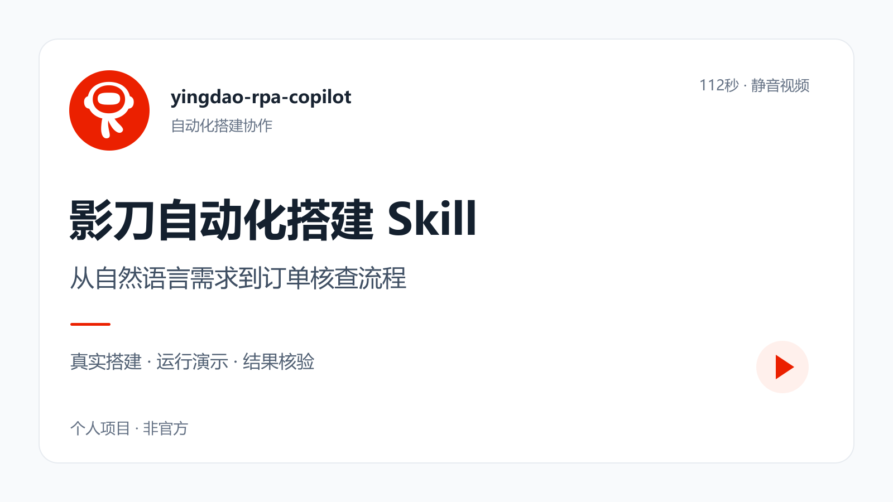

# 视频案例：从自然语言需求到订单核查报告

日期：2026-11-15。本次在独立演示应用中，使用全局`yingdao-rpa-copilot`方法、正常影刀客户端与任务局部适配，完成Excel订单核查及可追溯报告。它与11月14日源端或迁移案例、RPA Challenge是不同任务，不混用运行与验收数字。

[打开112秒视频](../media/yingdao-rpa-copilot-intro.mp4) · [媒体来源与许可边界](../media/README.md)

## 任务和实现

从16行练习台账读取订单编号、预期金额与预期状态，到练习商城按编号查询，输出“汇总”“逐行结果”“异常明细”。重复项保留来源行但不再查询或累计；冲突和输入问题单列；未找到不记零；金额和状态同时不符保留全部原因。

正式流程28节点，以VisualFlow完成筛选、循环、等待和网页读取；CodeFlow负责输入预检、精确匹配、Decimal比较和报表，2个In、1个Out。另有5节点当前页面只读采样；空main保留且未运行。环境为影刀6.3.39与Edge。

用户定义目标、打开应用/商城并正常登录、捕获4元素、修正一处过宽定位并提供反馈；Agent借助Skill组织方案、生成候选及代码，通过外部正常客户端配置与回读、受控运行和实际文件核验。复用历史练习台账、规则与部分实现，但没有复用旧元素ID、端口或已消费的运行授权。仓库没有捆绑这些现场执行器。

## 三段不同证据

|阶段|实际证据|结论范围|
|---|---|---|
|首次正式运行及独立验收|正式1次、约119.866秒；127项配置核对、229项实际内容核验；16行全部保留|本次正式运行通过，不是任意任务或环境的通用保证|
|支持重复运行的补丁|改为每次独立输出目录；4项本地行为检查、122项字段核对，恢复调用参数后保存|补丁当时没有整批现场重跑，不将首轮验收自动延伸至补丁后|
|后续用户手动运行录屏|录屏可见查询、报表生成与运行结束，随后打开三张结果表|只说明可见行为和报表展示；没有对新工作簿再做229项独立验收|

首次正式结果为一致5、差异3、未找到1、重复3、输入冲突2、输入问题2，合计16；查询9个唯一编号、8个可比较订单，异常明细11行。可比较预期金额336.96、实际325.96，网页减预期为-11.00。该结论来自这次实际查询与工作簿，而非套用历史分类数量。

40秒等待窗口到期时运行仍进行，只查询同一运行标识后确认完成，没有重跑。补丁修改代码后曾清空四处调用参数，Agent回读发现并恢复，未隐瞒副作用。视频中后续查询片段标注4倍速，等待与重复导航已剪除；全片静音。

## 适用边界

本次没有现场制造查询失败、会话失效、多精确候选或不完整分页结果；相关离线检查不冒充现场覆盖。现场执行需要当前正常接口、浏览器集成、人工准备和明确授权；不证明生产无人值守、通用自动搭建或跨设备迁移。

视频是已审阅成片，包含经过隐私处理的练习界面与对话片段；原始录屏、工作簿、日志、工程及内部来源台账不随仓库提供。自编内容、第三方Logo和外部软件界面的权利边界分别说明。
